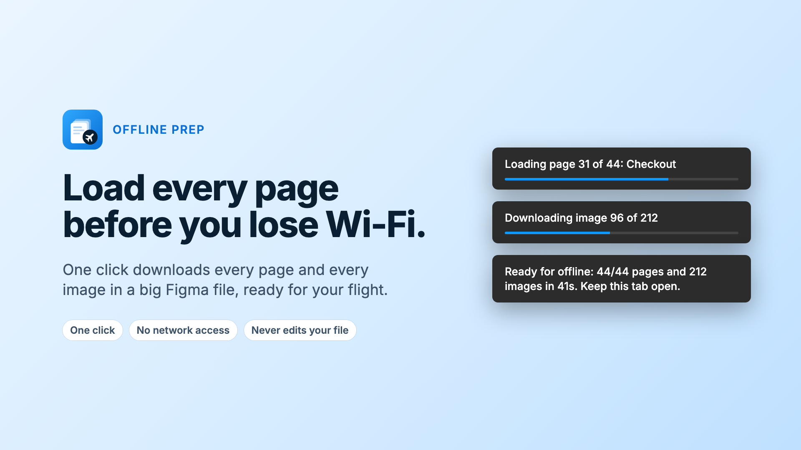

# Offline Prep



You're on the plane. Seatbelt sign's off, laptop's open, and you've got three uninterrupted hours to finally get through that redesign. You open the file. Page one loads. You click page two.

Unavailable offline.

Page three, the same. And the few images you can see are blurry smudges.

Figma only loads the page you're looking at, and only downloads full-quality images for what's on screen. Everything else stays in the cloud, a few hundred kilometres behind you.

**Offline Prep** fixes that with one click before you leave. It loads **every page** and downloads **every image** in the file, so when the Wi-Fi drops, your whole file comes with you.

Free, no settings, and it never touches your design. Works with Figma Design files.

## Install

**Figma Community:** listing coming soon.

**Use it now:** download this repo (Code > Download ZIP), then in the Figma desktop app go to Plugins > Development > **Import plugin from manifest...** and pick `manifest.json`. It's already built, so there's nothing else to do.

## How to use

1. Open the file while you're online.
2. Run **Offline Prep** from the plugins menu. There's nothing to set.
3. Watch the progress toasts ("Loading page 12 of 44", "Downloading image 96 of 212") until you see **Ready for offline**.
4. Keep that tab open. Figma can't reopen files offline.

Taking several files? Run it once in each and keep every tab open.

To stop it early, click **Cancel** on Figma's "Running Offline Prep" message.

## What it doesn't do

- It never edits your file or moves your view.
- It has no network access and stores nothing.
- It can't make library search, plugin installs, or fonts you haven't installed work offline. Those are Figma limits.

## Build from source

```bash
npm install
npm run build
```

`npm run watch` rebuilds on save. `npm run lint` runs Figma's ESLint rules, which catch APIs that break under `dynamic-page`.

## Install for development (Figma desktop app)

1. Open any Figma Design file in the desktop app.
2. Plugins > Development > **Import plugin from manifest...** and pick `manifest.json` in this folder.
3. Run it from the plugins menu. Figma reads `dist/code.js` fresh each run, so rebuilds are picked up without re-importing.

## Project layout

```
manifest.json      plugin manifest (dynamic-page, no network, no UI)
src/code.ts        everything: load pages, find and download images, report
dist/code.js       build output, referenced by the manifest
assets/            listing images; regenerate with `python3 assets/src/build.py` (needs Google Chrome)
LISTING.md         Community listing copy and data security answers
TEST_RESULTS.md    test log
```

## Known limitations

- Very large files may hit Figma's per-tab memory limit (about 2 GB).
- A plugin only runs in the open file, so each file needs its own run.
- Images are downloaded via `getBytesAsync()`. Whether that keeps them sharp offline still needs a real test (see `TEST_RESULTS.md`).

## Contributing

Issues and pull requests are welcome. Please keep it one click.

## License

[MIT](LICENSE)
